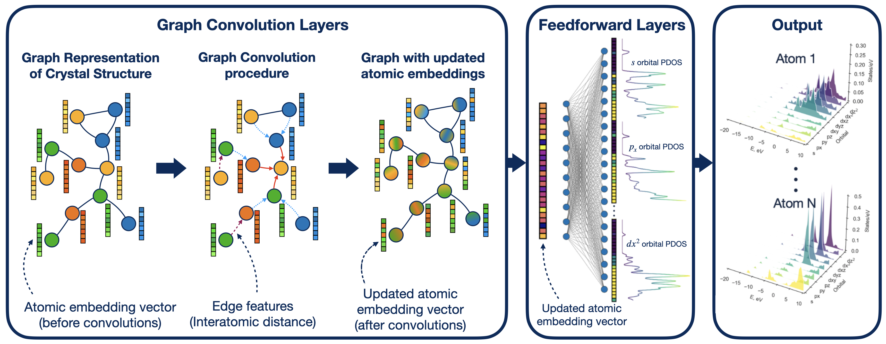

# ProDosNet: Navigating the Materials Space with ML-Generated Electronic Fingerprints

Code and models for the paper **["Navigating the Materials Space with Machine-Learning-Generated Electronic Fingerprints"](https://link.aps.org/doi/10.1103/g86f-dn26)**.

Identifying materials with strong performance in a target application usually means searching for compounds electronically similar to a known reference — but computing electronic structure (density of states, band structure) for hundreds of thousands of candidates via DFT is far too expensive for high-throughput screening. **ProDosNet** is a graph convolutional network trained on atom- and orbital-resolved projected density of states (PDOS) from the Materials Project that predicts electronic structure at a fraction of the DFT cost. We use it to generate PDOS fingerprints for 147,472 Materials Project compounds and show that clustering by PDOS similarity surfaces materials with similar electronic properties but very different crystal structures — with applications in photovoltaics, oxygen-evolution catalysis, solid-state Li-ion conductors, and battery cathodes.

<p align="center">
  
</p>

<p align="center">
  <em>ProDosNet architecture: graph convolution layers produce updated atomic embeddings, which feedforward layers map to orbital-resolved PDOS for every atom.</em>
</p>

Try the model interactively: **[ProDosMate](https://huggingface.co/spaces/inep/prodosmate)** (Hugging Face).

<p align="center">
  
</p>

## Table of contents
- [Repository structure](#repository-structure)
- [Installation](#installation)
- [CLI quick reference](#cli-quick-reference)
- [Data availability](#data-availability)
- [Citation](#citation)
- [License](#license)

## Repository structure

```
pdos_gnn/
  pdos_gnn/                 # Installable package: ProDosNet model + training/inference CLI
    main.py                   #   CLI entry point (--task preprocess|cross_val|test|predict)
    models/crystal_model.py    #   ProDosNet
    utilities/                 #   Data preprocessing, training loop, dataset, helpers
    pretrained/                 #   Pretrained model checkpoint
  scripts/                  # Standalone analysis/figure-generation scripts
  notebooks/                # Jupyter notebooks for analysis in the paper
  data/                     # Example/reference data 
  assets/                   # README media
```

## Installation

```bash
git clone git@github.com:ineporozhnii/pdos_gnn.git
cd pdos_gnn/
python -m venv pdos_gnn_env
source pdos_gnn_env/bin/activate
pip install -e .
```

## CLI quick reference

All tasks run through `pdos_gnn/main.py`:

```bash
# 1. Preprocess raw CIF + DOS data into crystal graphs
python main.py --task preprocess --preprocess_ids path/to/ids.csv --cif_dir path/to/cifs --dos_dir path/to/dos_json

# 2. Train via k-fold cross-validation (paper uses --use_cdf, the Wasserstein-equivalent loss)
python main.py --task cross_val --train_ids path/to/train_ids.csv --data_file path/to/processed_data.tar --use_cdf

# 3. Evaluate a trained/pretrained model on a held-out test set
python main.py --task test --test_ids path/to/test_ids.csv --data_file path/to/processed_data.tar --model path/to/checkpoint.pth.tar --use_cdf

# 4. Predict PDOS fingerprints for new materials (no DFT target needed)
python main.py --task predict --predict_ids path/to/ids.csv --cif_dir path/to/cifs --model pretrained/pretrained_pdos_model.pth.tar
```

## Data availability

Reference files (train/test material-id splits, materials property table, example CIF/DOS files) are included in `data/`.

## Citation

If you use this code, the pretrained model, or the generated PDOS fingerprints in your work, please cite:

> I. Neporozhnii, Z. Wang, R. Bajpai, C. Gomez, N. Chakraborty, T. Dong, I. Tamblyn, S. Hoogland, and O. Voznyy,
> *Navigating the Materials Space with Machine-Learning-Generated Electronic Fingerprints*,
> PRX Intelligence **1**, 013014 (2026). [doi:10.1103/g86f-dn26](https://doi.org/10.1103/g86f-dn26)

```bibtex
@article{g86f-dn26,
  title = {Navigating the Materials Space with Machine-Learning-Generated Electronic Fingerprints},
  author = {Neporozhnii, I. and Wang, Z. and Bajpai, R. and Gomez, C. and Chakraborty, N. and Dong, T. and Tamblyn, I. and Hoogland, S. and Voznyy, O.},
  journal = {PRX Intelligence},
  volume = {1},
  issue = {1},
  pages = {013014},
  numpages = {9},
  year = {2026},
  month = {Aug},
  publisher = {American Physical Society},
  doi = {10.1103/g86f-dn26},
  url = {https://link.aps.org/doi/10.1103/g86f-dn26}
}
```

## License

MIT — see [LICENSE](LICENSE).